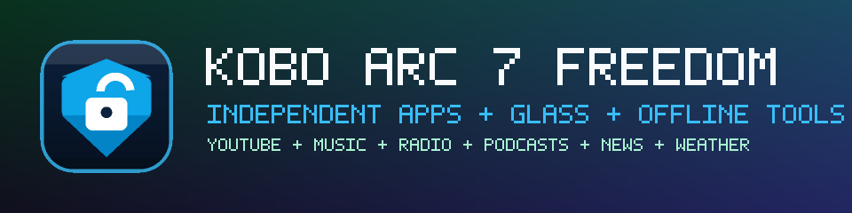

# Arc7 Freedom — v2.7.0



Native, separately installable apps for **Kobo Arc 7 / Arc 7HD, Android 4.0.3–4.2.2**.
Suite/default apps/upgrader: **2.7.0 / 270** · Home: **5.6.0 / 56** · F-Droid: **1306**.
API15 minimum / API17 target, ARMv7, DEX035 and the permanent signing certificate remain.

## This build

**[App tools: diagnostics, logs, low-RAM, storage and resumable uploads](releases/APP-TOOLS.md)** ·
[2.6 feature, installation and device-test guide](releases/SUITE-FEATURES.md) ·
[Glass, Music and optical QR guide](releases/GLASS-MUSIC-QR.md) ·
[Maintenance safety](releases/INSTALL-RUNTIME-FIXES.md) · [Weather details](releases/WEATHER-FEATURES.md)

- F-Droid defaults to **All** categories, distinguishes catalog/updates from actual
  installed apps, and adds the **pinned official F-Droid and Guardian archives** for
  legacy Android. Existing repository trust, credentials and user repositories stay intact.
- Patch management lives in **Arc7 Freedom → PATCHES**. PC USB/backup scripts and the
  upgrader do **not** force open an App Patches screen. Safe maintenance still runs.
- Separate **Radio**, **Podcasts**, **News**, **Authenticator** and **Passwords** apps.
  Radio keeps `ca.arc7freedom.radiorss` and existing data; the new apps have independent UIDs.
- **Podcasts favourites:** select a directory result and tap **Favorite**, then use **Quick search
  favorites** to filter saved shows instantly by title/publisher. The list survives restarts and
  filters offline; opening episodes still needs a feed connection. Up to 200 shows, with star removal.
- Canonical regional CBC MP3 mounts, a Toronto-only HLS fallback and literal error
  reporting for **MediaPlayer 1/1004** and **1/-1010**. No regional station substitution.
- **Apple-Liquid-Glass-inspired** translucent lenses, specular rims and capsule controls.
  Home's dock/top capsule use a small cached wallpaper frost; app surfaces use static ambient
  colour. API15-compatible, not Apple's renderer or live backdrop blur. Home layout controls
  remain; the in-app Quick App Bar Switcher is still removed.
- Weather explicitly shows **High / Low**. Its independent widget owns refresh/cache
  state; a signature-protected read-only bridge repairs legacy suite widgets without
  moving Weather networking into the suite.
- YouTube/Music recover bounded transient **unexpected-end-of-stream / I/O** failures:
  finite DASH ranges and buffered HLS playlist/remux resources use fresh connections and up to three whole-request
  attempts, discarding partial bytes and validating ranges/lengths. Denials/rate limits and
  malformed responses are not retried. The native TLS relay also finishes short socket
  writes instead of dropping their tails. This does not bypass provider restrictions or
  guarantee live YouTube availability; `-1004` is I/O, not proof of a codec problem.
- YouTube/Music use conservative H.264/AAC-LC selection and actual-player notification
  ownership. Verified, cancellable offline MP4/M4A downloads never save raw unsupported
  streams as a successful download. YouTube adds **local Pinned Channels** and public feeds.
- Music's **1/-1010** path now checks real AAC-LC decoder bytes, corrects sample-entry
  channel/rate fields, prefers audio-only M4A before HLS and can retry once as sample-exact
  AAC/ADTS. No transcoding or unsupported-codec promise; real Kobo playback still needs testing.
- Music's **`-38/0` player-state repair** keeps native time/transport/DSP calls out of async
  preparation and serializes them with release. Preparing/failed players are released directly,
  not stopped in an invalid state. `make test-audio-state` reproduces the old asynchronous-error
  bug with the production service and recording fakes; it is not physical Kobo playback proof.
- **Playback diagnostics / sound test** shows prepared/focus/buffering/container state where
  known and exact native error numbers. Three bundled, checksum-pinned quiet WAV/MP3/AAC-LC
  tones work offline; tests stop current playback, cancel its sleep timer and bypass app EQ,
  but never raise system volume. Actual audible output is explicitly confirmed by the user.
- Shared audio owners now coordinate **audio focus, headphone disconnects and legacy headset
  media buttons**. Duck, pause, guarded transient resume and explicit Play/Pause behavior are
  consistent; unplugging or a manual pause vetoes automatic resume. Foreground YouTube also
  pauses on disconnect; official VLC retains its native playback policy.
- **App tools → Low-RAM profile** optionally reduces artwork, thumbnail caches, worker queues,
  media-preparation admission and Home's wallpaper sampling without replacing transparent glass.
  **Storage** separately counts saved-media folders and managed/other cache; configurable
  **32–1024 MiB** limits and confirmed temporary-cache-only clearing preserve saved media,
  vaults, app data and both optical/LAN receive checkpoints. Active cache users block clearing.
- Each Arc7-owned app, Home, Aurora, upgrader and patched F-Droid gets its own private,
  bounded **debug log** (three × 128 KiB, 64 KiB report), with enable/clear/view and confirmed
  copy/save controls. Structured constants/counters/class frames omit URLs, tokens, exception
  messages and content. **Menu → App tools** or **App Manager → Manage app → App tools** opens
  the owner's screen. Official, upstream-signed VLC keeps its own debug recorder instead;
  those native logs are not Arc7-sanitized and need review before sharing.
- Music adds **Quick play**, **Artists** alongside song/album/playlist/community search, public
  artist songs/releases, saved collections and local playlists. Choose **Artists** beside the
  search field, type a name and tap **Go**; open an artist, then a song or album. Artist results
  are not fake playable videos and never silently fall back to unrelated songs. No account sync.
- YouTube and Music now give search its **own row** below a compact logo/title/**More** row.
  **More** holds app switching and Morphe settings; Music also keeps Equalizer and Sleep timer
  there. Short search-type labels and 48dp actions keep controls usable on narrow screens.
- Stream Deck edits keys **only in Edit Keys mode**, including long presses; ordinary
  taps/toggles and hold-to-talk never open the editor. Momentary keys own the complete
  touch gesture and release on cancel, layout/profile changes or app stop.
- Stream Deck has a touch key/modifier picker and strict keybind validation, ordered
  packets and per-client held-key ownership on the PC. Unsupported backends report errors.
- Local encrypted **Passwords** and **Authenticator** vaults import unencrypted Proton Pass
  and Bitwarden CSV/JSON exports locally. Password entries retain supported TOTP secrets;
  Authenticator imports valid TOTP seeds/`otpauth://` values. Imports append, skip duplicates,
  and never replace existing entries. Encrypted provider exports must first be exported as
  unencrypted CSV/JSON by the provider. Both apps keep encrypted backups and auto-lock, have no
  Internet permission, and remain **unsupported on security-obsolete Android 4.x and not
  independently security-audited**. No 2FA QR scanning, autofill, cloud sync or password recovery.
- Stronger shared **Liquid-Glass-inspired** material: transparent thick lenses, opposing
  specular/Fresnel/prismatic edges, floating headers, new glass icon tiles and multi-light
  page backgrounds. Home samples its cached wallpaper at different centre/edge scales;
  there is no live capture/blur of app content or Apple's proprietary renderer.
- **Files → Receive QR bytes**, and long-press **Send file bytes via QR (offline)**, transfer
  actual file bytes through multiple camera-scanned QR codes, without shared Wi-Fi. Repeats,
  out-of-order/missing frames, CRC32/SHA-256 and safe explicit saving are handled. **64 MiB max** (legacy mode: 1 MiB);
  use the new standalone **QR-Transfer.apk** for a built-in Kobo file picker, density controls
  and on-disk receive checkpoints/resume. Standard density takes about 27 minutes per MiB
  before retries; optical transfer is deliberately offline, not fast. Includes a self-contained [offline browser sender/receiver](tools/qr-transfer.html).
  Codes are not encrypted or authenticated; both ends need the Arc7 protocol.
- **Files → QR link · LAN share** separately displays a QR link for the currently selected folder inside shared
  internal storage. A computer/phone browser on the same LAN can upload and download files.
  The bundled offline uploader hashes incrementally and sends durable **1 MiB chunks**, up to
  **4 GiB per file**, with per-chunk and final SHA-256 verification. Pause/reselect the same file
  to resume from its acknowledged offset, including after restarting the share for the exact
  same root folder. Recovery lasts seven days; explicit partial-only cleanup is separate from
  media cache and optical QR data. Completed receipts are rehashed before reuse. The random
  link is temporary (30 minutes), folder-scoped and stopped from Files. The local HTTP
  connection is **not encrypted**—checksums do not authenticate peers; use a trusted network.

Provider sign-in/bot/age restrictions are reported, **not bypassed**. Host tests and media
decoding are not proof of live YouTube/CBC availability or physical Kobo behaviour.
Use this build's files or the matching **v2.7.0** GitHub release after its main-branch
workflow succeeds, not an older “latest” asset. See the guide's outstanding device checks.

### Release version consistency

The suite, upgrader, YouTube/Music and all 32 default apps now declare **2.7.0 / 270**
in the actual Android manifests, not just in the workflow title. Home/store versions and
all package names, private data and the permanent signer are retained. The builder, Wi-Fi
portals, host tools, checksums and upload lists use **Upgrade-My-Kobo-To-v2.7.0.apk**.
Older upgrader APKs are removed from the current build and their Git deletions are staged.

`make test-release` checks version/path consistency before a long build and reproduces the
label-only bump/missing-artifact failure with offline fixtures. Before Git staging/upload,
`python3 scripts/check-release-version.py --artifacts` checks the exact files and all 53
SHA-256 entries. Full `make verify` also inspects the actual signed APK version names/codes.

## Expanded Weather (retained)

The independent **Weather** app now includes:

- Current conditions and feels-like, humidity, wind/direction/gusts, pressure, cloud
  cover, visibility, dew point, precipitation and UV (with hourly fields labelled).
- **48 upcoming hours**, interactive temperature/rain-chance/wind charts, and a
  **14-day outlook** with high/low ranges and detailed daily/hourly breakdowns.
- Search with multiple city matches, **12 saved places**, rename/remove/reorder,
  manual coordinates and an optional **one-time** Android network/GPS lookup.
- Air quality (US/European AQI, pollutant details and outlook), regional pollen,
  sunrise/sunset/daylight/sunshine, and a labelled approximate moon phase.
- **Official Canada (ECCC) / US (NWS) alerts**, instructions and optional deduplicated
  notifications; other regions and failed/incomplete/stale checks are explicitly marked.
- On-demand, native **past-radar** map with frame playback, pan/zoom and a bounded tile
  cache. Public RainViewer supports past precipitation only, at zoom levels up to 7;
  blank radar is not an all-clear. No future radar or satellite imagery is promised.
- Configurable units/time, share forecast, refresh intervals/network policy, and a
  home-screen widget with real refresh, today's range and timestamp/stale status.

No fabricated weather defaults, account, API key, Play Services or root requirement.
Each city has its own private offline cache, provider errors cannot overwrite the last
usable response, and old-city/cancelled requests cannot replace the selected city.
Location is opt-in and never tracked in the background. Pollen and forecast variables
have provider-dependent coverage; notifications are **polled, not emergency broadcasts**.
The existing API15/17 / ARMv7 / DEX035 and independent-UID networking design is retained.

The suite/upgrader now use **v2.7.0 / 270** and the same signing certificate;
the maintenance pipeline also recognises same-version changes by verified APK hashes.
GitHub release publication requires a successful main-branch workflow. `make test-weather` runs the offline
executable regressions; `make verify` also includes them. See the guide for limitations
and the remaining real-device checks.

## In this branch: every install method applies the same patches + F-Droid fix

**Requirement update:** the earlier requirement to have all network traffic go through
Kobo Arc 7 Freedom is **withdrawn**. This does not require removing existing work.
Independent per-app networking remains the current default; existing optional proxy,
VPN and USB-networking tools are retained.

The signed **v2.7.0 / 270** suite/default-app/upgrader builds and **F-Droid 1306** are on
this working branch. Use the local build/Wi-Fi portal or the matching v2.7.0 release after
the main-branch workflow publishes it; an older “latest” asset may not contain these changes.

### One complete offline patch bundle

**Direct APK, microSD, Wi-Fi/OTA, USB/ADB, backup tools and the upgrader now join the same
maintenance pipeline.** Install `releases/KoboArc7Freedom.apk`, open Arc7 Freedom once,
and use **PATCHES → Apply / Retry All Patches**.

- **38 APKs bundled offline:** Home, F-Droid, Aurora, VLC, YouTube, YouTube Music and **all
  32 separately packaged default apps**, including Clock/Music/Radio/Recorder and Package
  Installer. Shared ZIP bytes are stored once and reconstructed exactly; installed apps
  keep their independent identities/UIDs/data/networking.
- **Rooted:** automatic in-place updates, same-version SHA-256 comparisons and installed
  read-back. Newer apps are kept. A signature/storage error leaves the installed app and
  data intact—no automatic uninstall or data clear.
- **Unrooted:** the visible **Install pending apps** queue opens Android's confirmation
  for each APK. Cancelling pauses safely. Root-only patches remain visibly pending;
  downloading an APK is not reported as installing it.
- **Shared system repair:** old Arc7-only proxy cleanup, per-app CA/TLS assets, backed-up
  offline system CAs and Python/apt/TLS tools with root, Home provisioning and restored
  schedules. Online time/chime work is separately reported/deferred.
- **Boot, suite replacement/startup, successful rooting and in-place conversion** retry
  unfinished work. Generated Clean Android ROM ZIPs include the full suite and run the
  same maintenance after boot. Reinstall the suite after an arbitrary third-party ROM.
- **F-Droid 1306:** fixes `java.util.ArrayList cannot be cast to java.lang.String[]` by
  normalizing repository mirrors **and push-request arrays**, retaining existing repository
  data and signature/TLS/low-memory patches.

Rooting, OS conversion/stock-app removal, boot/recovery flashing, wipes, storage policy,
ad blocking, proxy/VPN and tethering remain **separate explicit choices**, not implicit
maintenance steps. Back up important data before an update or signing-key migration.

Individual APKs are still available in `releases/` and generated `releases/apps/` for
one-app updates. **`releases/SHA256SUMS.txt`** covers the whole build. Use the full suite
or upgrader when you want every relevant patch applied; a standalone app cannot silently
patch another UID. The main-branch workflow publishes the matching verified release.

### Notification, playback, installer and obsolete-proxy repairs

**Install checklist: [releases/INSTALL-RUNTIME-FIXES.md](releases/INSTALL-RUNTIME-FIXES.md).**
This is the v2.7.0 maintenance build; publication is gated by the main-branch workflow.

- **VLC and other players own their notifications.** Arc7's external-audio observers update
  Clock/widgets silently; only a prepared player in the actual owning APK can post Arc7
  media controls. Update the suite **and installed Clock, Music, Radio, Podcasts, Voice
  Recorder, YouTube and YouTube Music APKs**, then reboot/force-stop their old processes.
  The full suite now updates those standalone APKs through the shared pipeline; verify
  their results in the patch report. Keep VLC's own notification.
- **YouTube playback is separate from metadata.** The resolver uses the maintained native
  visionOS 1.04 request shape (matching UA/device/WATCH/MOBILE context, per-client visitor
  data, mobile `t`/`id` parameters and playback nonce), then iOS / TV fallbacks. HLS is
  parsed/probed and relayed through the owning APK's TLS engine, not handed to old
  Stagefright as an HTTPS MP4. Finite fMP4 HLS and DASH are disk-spooled into classic MP4/M4A
  with H.264/AAC tracks. Unsupported codecs/DRM and failed streams are reported honestly.
  An unknown-length preparation never advertises partial output as a finished file; a
  stalled preparation returns an error. Playback readiness follows player preparation and
  start, with generation guards, cancellation and a 125-second preparation timeout.
- **YouTube silent-video repair:** Android 4.2 ignores separate MPEG-TS HLS audio renditions.
  Playback now prefers combined renditions, verifies real TS program/audio tables, and
  falls back to the H.264/AAC DASH remux or another client instead of opening silent video.
  Separate fMP4 audio/video remains supported by the remuxer. A prepared player reporting
  no audio gets one combined-track recovery attempt, not a false Playing state.
  Install this branch's [YouTube.apk](releases/YouTube.apk) **in place** (or verify its update
  in PATCHES); an older public “latest” APK does not include this repair. **YouTube → Sound**
  shows the audio check and controls **media** volume. Volume buttons target media, and
  audio focus loss pauses/ducks playback. Volume and speaker/Bluetooth routing are never
  forced automatically. Real tablet output still needs a device test.
- **App Info/uninstall targets the real app.** Updated Home canonicalizes legacy Package
  Installer shortcuts to `ca.arc7freedom.packageinstaller`, without substituting the suite
  if that separate app is absent. The optional updater is `ca.arc7freedom.upgrader` and has
  its own **App Info / uninstall this upgrader** button. In-place suite/Home/media/store
  updates no longer silently uninstall on signature/storage errors. The explicitly
  destructive **Clean Reinstall** action has an additional package-specific confirmation.
- **The suite retries obsolete global and saved-Wi-Fi proxy removal automatically.** Only
  `localhost:8118` / `127.0.0.1:8118` are matched. Other proxies, credentials, static IP/DNS,
  VPNs and USB routes are preserved. Cleared Wi-Fi entries do not hide a remaining global
  proxy; denied/unverifiable cleanup remains pending and shows manual instructions.

**Validation boundary:** offline tests exercise actual visitor/player HTTP requests against
an enforcing fixture gateway, real synthetic H.264/AAC media, explicit audio-track decoding
and non-silent PCM checks with FFmpeg (including separate-TS → DASH recovery),
Range/HEAD/error behavior, pending-file/cancellation races and fake Android ownership/proxy
APIs. **They do not prove live YouTube access or playback/notifications on a physical Kobo.**
Those still require a tablet test; age/sign-in restrictions, server changes, codecs and ROM
permissions can prevent playback. Finite fMP4 needs cache space and may take time to prepare.

### No more shared network funnel

- The 32 default apps and YouTube / YouTube Music launch their **own packages**, including
  from Home's dock, the shared app bar, file-open shortcuts and widgets. An absent app shows
  installation help instead of silently running another copy inside Arc7 Freedom.
- Each network-enabled APK starts its own native TLS engine **under its own Android UID**,
  on a stable package-specific loopback port. Sharing Java source/class names does not share
  a process, private data directory, permissions or network accounting. Offline apps such as
  Calculator and Notes do not even request `INTERNET` or run a gateway.
- Aurora Store and patched F-Droid also bundle their **own** native engine and CA bundle
  (`21118` and `21120`, respectively); neither needs the suite running. F-Droid migrates old
  `8118` repository addresses without changing repository certificate pins. Official VLC
  already owns its network stack; the optional fallback player now owns its TLS bridge too.
- Certificate installation no longer enables a global HTTP proxy. On startup/upgrade the
  suite retries removal of **only its old `localhost:8118` / `127.0.0.1:8118` global and saved
  Wi-Fi proxies**. Global changes normally require root; saved Wi-Fi cleanup uses the ROM's
  Wi-Fi API where permitted. **Use Independent Networking** retries manually. If cleanup
  remains pending, change only networks with that old proxy to **None** in Android settings;
  unrelated work/school proxies are left alone.
- The optional **legacy global proxy**, an explicitly enabled VPN, or the userspace USB
  internet tunnel can still combine traffic under their owner's UID on Android 4.x. Turn
  those modes off when you want direct per-app Wi-Fi/Bluetooth accounting. Port `8118`
  remains available for third-party apps that you deliberately configure to use it.
- Existing standalone app data is retained by in-place APK updates. Data from old *in-suite*
  copies stays in the suite and is **not silently shared, deleted or moved**. Export/import
  anything you need from those old copies. Clock/Calendar schedules and Clock/Calendar/
  Weather/Music widgets now belong to their own apps; replace legacy suite widgets with the
  corresponding standalone widget to see that app's data.

### QR Transfer app & repaired Windows tools

Install **`QR-Transfer.apk`** (`ca.arc7freedom.qrtransfer`) from the matching build's
`apps` folder. Open **QR Transfer**, choose a file with its built-in storage browser (or
another app's picker / Share action), then show its QR codes. The other device uses
**Receive**, Files' existing **Receive QR bytes**, or the same
[offline webpage](tools/qr-transfer.html). Nothing is uploaded, opened or installed
without your action. New v2 supports **64 MiB**, Easy-focus/Standard/Dense profiles and
native **Saved receives → Resume / Discard**. Reselect identical bytes, filename and
profile at the sender to continue. The webpage's unsaved receive data lasts only while
it stays open; older apps/pages need **Legacy v1** (1 MiB) sending. [Protocol and limits](releases/GLASS-MUSIC-QR.md).

**Bluetooth Internet has been removed** from source, manifests, default app bundles and
the installer catalog. It is not replaced with another Bluetooth/Wi-Fi tethering app.
Already-installed copies are not silently uninstalled; remove an old copy through Android
Settings if wanted. Old pinned `@bluetooth` controls now open Android's Bluetooth settings.
Wi-Fi & VPN, USB Internet and normal OS Bluetooth settings remain.

On Windows, download **[Windows-Tools.zip](tools/Windows-Tools.zip)** from the matching PR
artifact/release and **Extract All** before running a launcher. All six tracked `.bat`
files (including the Kobo's Stream Deck mirror) now use small ASCII/CRLF wrappers and a
matching SHA-256-pinned PowerShell helper. Paths do not depend on the current working
directory; failures are visible and propagate a nonzero exit code. Wi-Fi/USB/backup need
no Python/admin URL reservation; Stream Deck probes Python 3.9+ and starts the app only
once. USB updates never uninstall/clear data to work around errors. See
[Windows setup, arguments, offline use and troubleshooting](tools/WINDOWS-TOOLS.md).

### Import passwords and 2FA codes

1. In Proton Pass or Bitwarden, export the vault as **unencrypted CSV or JSON**. Encrypted
   provider exports cannot be decrypted by Arc7. Transfer the export to the Kobo (USB, microSD,
   or the QR share below).
2. Open **Passwords** or **Authenticator**, unlock/create its encrypted vault, and tap
   **Import Proton Pass / Bitwarden export…**. Select the local file and review the summary.
3. **Passwords** imports login fields and supported TOTP secrets attached to logins. **Authenticator**
   imports valid Base32 / `otpauth://totp` values. Import the same export into both apps if you want
   the login and code in both places. Existing entries are retained; duplicates are skipped.

Imports are parsed locally, never uploaded, and limited to 4 MiB per file / 200 entries per vault.
Only login credentials and supported TOTP secrets are imported; passkeys, provider-encrypted files,
push approvals and recovery codes are not. Keep provider recovery codes separately. These apps
remain unsupported on security-obsolete Android 4.x and have not had an independent security audit.

### Share files between the Kobo and a computer with a QR code

1. Open **Files** and navigate to the folder you want to transfer (for example `Download`). QR
   sharing is limited to folders inside shared internal storage, not `/` or private app data.
2. Tap **QR link · LAN share** in the bookmark strip and confirm. Scan the displayed QR code with
   the computer/phone camera, or type the shown address into a current desktop/phone browser.
   Both devices normally need to be on the same Wi-Fi/LAN.
3. The offline browser page can **download from** the Kobo and **upload to** that folder. Uploads
   use durable 1 MiB chunks, per-chunk and final SHA-256 checks, with a 4 GiB per-file limit subject
   to filesystem/free space. Existing files are not overwritten; collisions get numbered names.
   Identical name/bytes reuses its still-valid, rechecked completion receipt rather than duplicating.
4. To resume after interruption, reselect the exact same file and click Upload. After share expiry,
   start a new share for the exact same Kobo root folder and use its new link. Recovery lasts seven
   days; stop sharing before the Kobo's confirmed **Pending uploads** cleanup. Stop the share when
   finished. See [upload details and limitations](releases/APP-TOOLS.md#5-large-file-trusted-lan-uploads-resume-and-final-sha-256).

The random bearer link expires automatically after 30 minutes and can be stopped earlier. Anyone
who gets the link and can reach the Kobo can access that one folder while the share is active.
This is a local HTTP connection with **no encryption**; use a trusted Wi-Fi network and do not use
it for sensitive data. No cloud relay or router port-forwarding is used. Android keeps a foreground
notification while the share runs.

### Regression checks and device acceptance

```sh
make test-isolation
make test-runtime
make test-audio-state
make test-reliability
make test-features
make test-discovery
make test-release
make test-fdroid
# Stronger host media validation with an available FFmpeg binary:
FFMPEG=/path/to/ffmpeg make test-runtime
# Optionally test two native gateways concurrently after building a host TLS binary:
python3 scripts/test-app-isolation.py --native build/native/host/arc7tls
# Normal release build (includes QR Transfer and the independent store transports):
./scripts/build-all.sh
make verify
```

**Automated validation:** offline feature tests cover vault encryption/TOTP vectors, Proton/Bitwarden
CSV/JSON import, duplicate/size limits, and the real QR-share HTTP server (auth, CSRF, traversal,
upload, download, ranges and stop). Reliability regressions add log rotation/privacy/permissions,
low-RAM worker admission, active-cache cleanup/combined-spool budgets, durable checkpoint restart,
checksum rejection, rehashed completion receipts and production offline browser SHA/resume code.
The full verifier checks initialized App tools/asset coverage in all 39 owned shipped APKs, while
retaining official VLC's separate native recorder/signature. Discovery tests exercise persistent podcast favourites,
local filtering and the production two-row header with recording layout/event fakes; Music
fixtures exercise actual artist-filter requests and artist-scoped songs/releases. The full
verifier also covers ARMv7/API17 builds,
permanent-certificate signing, DEX/manifest/payload checks, host-native independent gateways,
fixture media, FFmpeg decoding, catalog migrations and earlier reader regressions.
See [2.6 results and limitations](releases/SUITE-FEATURES.md#validation) for this build's results.
Aurora, F-Droid's injected Java and the fallback VLC transport compile against API17. No Android device, Bluetooth radio or PAN internet connection was available
for hardware verification.

The offline suite checks generated manifests/permissions, stable non-colliding ports,
URI/extras/grant-preserving navigation, legacy shortcut migration, owner-scoped proxy
cleanup, F-Droid DB migration and fake Bluetooth hardware/PAN failures. Host tests do not
replace testing the actual tablet's radio, ROM permissions or Android data counters.

On the tablet: update the main APK, Home, stores and the standalone apps you use **without
uninstalling or clearing data**; disable the old suite proxy/optional VPN; open Browser and
Weather; force-stop Arc7 Freedom; confirm both apps still fetch over Wi-Fi or Bluetooth PAN
and appear separately in Settings → Apps / Data usage. Also test simultaneous apps, app
force-stop/restart, Clock alarms after reboot, file-open hand-offs and both Bluetooth
sharing directions on supported devices.

---

### Earlier repairs retained in 2.6.8

These existing repairs are not new device-validation claims:

1. **The E-Reader is now a real page-turner.** Tap the **right** side of the page (or swipe left)
   for the next page, the **left** side (or swipe right) for the previous one, and the **middle**
   to hide/show the toolbar for full-screen reading. Pages are screen-sized: a whole-book EPUB that
   used to be one endless scroll now turns page by page, and turning past the end of a chapter
   rolls straight into the next one (and back again). A+ / A- and the theme buttons re-flow the
   text but keep your exact place, the position is remembered per chapter, the page counter shows
   `chapter/total · page/pages · %`, the layout uses the full 600 px screen instead of a 760 px
   column with 26 px gutters, and images/pre/tables can no longer overflow. Comic `.cbz` pages get
   the same left/right tap zones plus swipe, and the screen stays awake while reading.
2. **The Tailscale Google sign-in page now opens by itself.** Before, the tablet only drew a QR
   code and waited — and if the login link arrived after the old 12-second window it was dropped,
   so the page never appeared. Now the login link is captured for a full 30 s window, a late link is
   still picked up and opened automatically, the daemon's stdout is drained (a full pipe used to
   freeze `tailscaled`, so the URL never came out at all), `/register/` Headscale links are
   recognised, and the page opens in a real browser first (Google OAuth refuses embedded WebViews)
   with Arc7 Browser (TLS 1.3 bridge) as the fallback. There is also **Copy Login Link** and a
   **tailscaled Diagnostics** view.
3. **Every default app is a separate, installable app.** Browser, Clock, Calculator, Notes,
   Files, PDF Reader, Weather, Radio, Podcasts, News, Authenticator, Passwords, Photos, Camera, Calendar, Books, Music, Terminal,
   App Manager, Package Installer, USB Internet, Wallpapers, Games, Ad Blocker, System Boost,
   Second Screen, Split View, Wikipedia, Stream Deck, Voice Recorder and Wi-Fi & VPN each ship as
   their **own signed APK** (`releases/apps/*.apk`, published as `Browser.apk`, `Clock.apk`, …).
   Each has its own package id (`ca.arc7freedom.browser`, `ca.arc7freedom.clock`, …), launcher
   icon/label, task stack, data directory and row in *Settings → Apps* — install, update or
   uninstall any of them on its own. Standalone apps retain their declared names and logos; similar
   stock apps keep their original icon. The suite keeps a forwarding/install-help `<activity-alias>` shortcut and
   `SplitAppPackageReceiver` + `SplitAppIconSync` update it immediately on standalone install/removal,
   so duplicate Camera or other twin entries do not linger until reboot.
4. **The over-the-air installer website works again.** Download buttons are plain
   `<a href>` links now — the old `onclick='onStartDl(...)'` handlers were undefined on the
   static page, so taps on a 4.2 Browser could do nothing at all. Links are root-absolute,
   there are short `/dl/<key>` URLs (e.g. `http://<pc-ip>:8000/dl/clock`) and `?file=Clock.apk`,
   a text-only `/lite` page for the stock 2013 browser, `/apps/<Name>.apk` serves the separate
   apps (falling back to the GitHub release), and the 1-click `Start-Kobo-WiFi-Server.sh/.bat`
   launchers now start serving immediately and download in the background.
5. **Alarms can now be set for specific days.** The alarm editor shows a **Sun · Mon · Tue · Wed ·
   Thu · Fri · Sat** row of check-off buttons (plus `Every day` / `Weekdays` / `Weekends` /
   `One-time` shortcuts). Any subset is saved as the alarm's day bitmask — e.g. Mon+Wed+Fri — and
   `AlarmManager` only fires on the checked days. Alarm cards show `Every Mon`, `Mon, Wed, Fri`,
   etc., and leaving every day unchecked gives a one-time alarm.
6. **F-Droid no longer crashes right after a sync.** The crash happened in the code that runs
   *after* the index has already been downloaded, verified and stored. In
   `org.fdroid.fdroid.UpdateService.onHandleIntent(Intent)` those calls —
   `notifyContentProviders()` (refresh the app list) and `performUpdateNotification()` (query
   `AppProvider.getCanUpdateUri()` with `Schema.AppMetadataTable.Cols.ALL` and build the
   "updates available" notification) — sit at bytecode offsets **648** and **678**, i.e. *after
   the method's last `try` range* (which ends at code unit `406`). Any `RuntimeException`
   thrown there (`SQLiteException` on a stale database, `IllegalArgumentException` from
   `App(Cursor)` / `checkCursorPosition()`, NPE inside `NotificationCompat`, an
   `OutOfMemoryError` from the 2026 ≈4,000-app index, …) therefore escaped the `IntentService`
   worker thread, killed the process and looked exactly like "syncs, then crashes".
   Patched **F-Droid `v1306`** now:
   * retargets both post-sync call sites (`invoke-direct/range` → `invoke-static/range`) to
     **`Arc7Bridge.safeNotifyContentProviders()` / `safePerformUpdateNotification()`**, which run
     the original private methods reflectively inside a `catch (Throwable)` — a broken refresh or
     notification step now only loses that step while F-Droid stays open;
   * records guarded failures and uncaught Java crashes in the **bounded private App tools
     log**, using class/frame identifiers without exception messages, causes or repository
     URLs, and delegates crashes to Android's previous handler. A private startup provider
     preserves `FDroidApp`; the older raw `files/arc7-last-crash.txt` collector is retired
     and that obsolete file is removed, not mirrored to logcat;
   * retypes **every `UpdateService.onHandleIntent()` catch handler to `java.lang.Throwable`**, so
     anything thrown *inside* the sync itself becomes a clean *"error updating repository"*
     status instead of a force-close;
   * declares **`android:largeHeap="true"`** in its binary `AndroidManifest.xml` (the upstream
     debug manifest ships without it), lifting the per-app Dalvik heap ceiling for index parsing;
   * hardens F-Droid's own `127.0.0.1:21120` TLS bridge / icon downloader so no unchecked exception
     (`ClassCastException`, bad URL scheme, …) can escape into UIL or F-Droid.

Since `v2.5.0` (still included):

1. **YouTube & YouTube Music media pipeline.** Metadata can load even when no media URL
   is usable. The current binder handles H.264/AAC progressive MP4, separate DASH tracks,
   MPEG-TS/AAC HLS and finite fMP4 HLS independently, probes media bytes and builds classic
   non-fragmented MP4/M4A for Android 4.2. Unknown output lengths wait for full preparation
   rather than guessing a `Content-Length` from input downloads. Foreground metadata
   enrichment is asynchronous and client attempts are bounded. See the maintenance notes
   above for current request profiles and the explicit live/device-test limitation; the
   original blanket claim of working 2026 streams was not established by host tests.
2. **Custom apps are genuinely separate applications.** `YouTube` and `YouTube Music` are now
   their **own installable APKs with their own package ids** — `ca.arc7freedom.youtube`
   (`releases/YouTube.apk`) and `ca.arc7freedom.ytmusic` (`releases/YouTubeMusic.apk`). Each has
   its own launcher icon/label, task stack, data directory and background services, appears
   separately under *Settings → Apps*, can be updated or uninstalled on its own, and cross-launches
   the other app. The suite no longer shows duplicate YouTube / YouTube Music icons; the 1-Tap
   Upgrader and the silent companion updater install and refresh both standalone APKs.

Everything from `v2.4.1` and earlier is still included: Launcher `v56` with effortless widget
removal, owned-player Now Playing controls + silent external Clock Standby metadata, Official Tailscale Google sign-in,
patched F-Droid `v1306`, bundled VLC, Aurora Store, `python3` + `apt`, 120 pre-downloaded 2026
Root CAs, the zero-SSL local Wi-Fi installer portal and the full app suite.

## App Manager & Repository Layout

- **Uninstall from App Manager:** open an app's **Manage** menu and select **Uninstall App**;
  Android's own Package Installer asks for final confirmation. User-installed apps and updated
  system apps are supported. The running App Manager itself, core Android services, the package
  installer, device drivers, and the only enabled Home launcher are protected. Preinstalled system
  apps can still be safely frozen or unfrozen, but their system-image APKs are not deleted.
- **Consistent Android module layout:** each installable project uses the standard
  `src/main/AndroidManifest.xml`, `src/main/java/`, and `src/main/res/` structure:

  ```text
  app/                 main Arc7 Freedom application and shared app code
  launcher-android4/   Home launcher
  aurora-store/        Aurora Store client
  vlc-player/          local VLC-compatible player fallback
  upgrader/            1-tap system updater
  split-apps/          generated per-app manifests + apps.tsv build index
  native/              ARMv7 native source
  scripts/             build, generation, patching, and verification tools
  tools/               user-facing host utilities and installer servers
  releases/            intentionally tracked release APKs, portal, and host tools
  ```

  All five full Android modules are declared in `settings.gradle`. `scripts/build-all.sh`
  remains the reproducible signed release build; it reads from these standard module paths and
  writes release outputs to `releases/`.

---

## Build downloads

Install in place; do not uninstall or clear app data to update.

| File | Purpose |
| --- | --- |
| [KoboArc7Freedom.apk](releases/KoboArc7Freedom.apk) | Full **38-APK** offline maintenance bundle; open the app, then **PATCHES** |
| [Upgrade My Kobo 2.7.0](releases/Upgrade-My-Kobo-To-v2.7.0.apk) | Same full suite bundled in a helper; does not force a patch screen |
| [Home](releases/VanillaAndroid4Home.apk), [F-Droid](releases/FDroidClassicLegacy.apk), [Aurora](releases/AuroraStore.apk), [VLC](releases/VLC.apk) | Independent companion updates |
| [YouTube](releases/YouTube.apk), [YouTube Music](releases/YouTubeMusic.apk) | Independent media updates |
| `releases/apps/*.apk` | **32** generated default-app APKs; [identity/file index](split-apps/apps.tsv) |
| [SHA256SUMS.txt](releases/SHA256SUMS.txt) | Checksums for every built APK and portal/host assets |

The default apps and deduplicated payload chunks are generated/ignored, following repository
conventions; the signed suite/upgrader embed their exact bytes. GitHub Actions also uploads
them in its build artifact. The local Wi-Fi portal (`tools/Start-Kobo-WiFi-Server.sh/.bat`)
serves the current files. A published [GitHub latest release](https://github.com/mob5824m-wq/Kobo-Arc-7-freedom/releases/latest)
may still be an older build until this work is merged and released.

Permanent certificate SHA-256:
`11:FD:17:ED:80:C9:13:EF:CB:F9:8F:76:73:DA:00:90:42:E7:64:7E:44:E5:D6:C5:F4:2F:CA:A5:CE:4C:D1:0F`.

---

## Earlier alarm and F-Droid stability repairs (retained)

1. **Per-day alarm check-off (`Arc7ClockActivity` + `Arc7ClockStore`):**
   - The `Repeat` cycle button is gone; the alarm editor now has seven toggle buttons
     (`Sun … Sat`) that light up when checked, a live `Repeat: Mon, Wed, Fri` summary, and
     one-tap presets (`Every day`, `Weekdays`, `Weekends`, `One-time`).
   - `repeatMask` (bit 0 = Sunday … bit 6 = Saturday) is persisted exactly as checked, so
     `computeNextTriggerMillis()` / `AlarmManager.set(RTC_WAKEUP, …)` already honour any subset.
   - `Arc7ClockStore.describeRepeatMask()` / `describeAlarmDays()` render single-day alarms as
     `Every Mon` and the alarm list keeps showing the full day summary.
2. **F-Droid `v1306` sync stability:** the two post-sync calls of
   `UpdateService.onHandleIntent()` (`notifyContentProviders()` @648, `performUpdateNotification()`
   @678 — both outside every `try` range) are retargeted to
   `Arc7Bridge.safeNotifyContentProviders()` / `safePerformUpdateNotification()` reflective
   `Throwable` guards, so a failing refresh/notification no longer force-closes the app; all
   in-sync handlers are retyped `Exception → Throwable`, the binary manifest gains
   `largeHeap="true"`, and `Arc7Bridge`/`BaseImageDownloader` reject bad URLs/types instead
   of throwing. The earlier raw `files/arc7-last-crash.txt` collector has now been replaced
   by the bounded, sanitized private App tools logger (including caught-operation and
   uncaught-crash frames); its bootstrap preserves the original `FDroidApp`. The stability
   repairs remain in the current 1306 build.

## What's New in `v2.5.0` (still included)

1. **`YouTube` media pipeline (`MorpheRemuxer` + `MorpheStreamServer` + `MorpheEngine`):**
   - Empty-`formats` DASH handling, video-only `avc1` + audio-only `mp4a` merge into seekable
     classic MP4, exact-output-length local `206` server and H.264/AAC ≤720p/30fps filtering
     for the MT8125 decoder, quality selection and error reporting, plus the
     existing SponsorBlock auto-skip, Return YouTube Dislike, comments, background audio and
     offline `.mp4` downloads.
2. **`YouTube Music` — real background audio:** audio-only DASH spool (no video download),
   AMOLED player, synced LRC lyrics, queue/shuffle/repeat, 5-band equalizer + bass boost, sleep
   timer, liked songs and offline `.m4a` downloads.
3. **Truly separate apps (`split-apps/`):**
   - New reusable `build_standalone_app()` build step produces signed `YouTube.apk`
     (`ca.arc7freedom.youtube`) and `YouTubeMusic.apk` (`ca.arc7freedom.ytmusic`) from their own
     manifests, with their own icons, labels, tasks, services and data directories.
   - The suite keeps only compatibility/deep-link entries (no duplicate launcher icons); the
     launcher, 1-Tap Upgrader and silent updater all prefer the standalone packages with a
     install help when the separate package is absent (no hidden in-suite copy).
4. **Verification:** new `verify_v250_streaming_and_standalone_apps()` gate (package ids, labels,
   launcher filters, v1+v2+v3 signatures, embedded CA bundle + TLS engine, 2026 InnerTube strings,
   upgrader nesting) and a host-JVM suite `scripts/test-morphe-remux.py` that proves the remuxer
   and the strict Range/`206` server byte-for-byte.

---

## What's New in `v2.4.0`

1. **`YouTube` App — Morphe Edition (`YouTubeActivity` + `MorpheEngine`):**
   - Introduced the local Range/TLS stream proxy, hardware H.264/AAC playback path, SponsorBlock,
     dislike counts, channels, comments and offline downloads. Original client versions in
     this historical release are not a guarantee of current service access; use the
     maintenance profiles/pipeline and testing caveats above.
2. **New Standalone `YouTube Music` Morphe App (`YouTubeMusicActivity`):**
   - Dedicated launcher app with AMOLED dark UI, song/album/artist/playlist search & quick picks, `128–160 kbps` M4A screen-off background playback (`PARTIAL_WAKE_LOCK` + `WIFI_MODE_FULL_HIGH_PERF`), SponsorBlock non-music skip, synced LRC lyrics, queue/shuffle/repeat, 5-band `Equalizer` + `BassBoost`, and offline `.m4a` downloads.
3. **Effortless Home Screen Widget Removal (`VanillaAndroid4Home v54`):**
   - Custom `InterceptingWidgetHostView.onInterceptTouchEvent` intercepts `420ms` long-presses before clickable child `RemoteViews` swallow them, **`Rearrange`** mode highlights every widget with 1-tap **`✕ Remove`** + **`↕ Size`** badges, and Home long-press shows active page widgets right at the top with 1-tap **`✕ Remove`** (`AppWidgetHost.deleteAppWidgetId` + persisted removal).
4. **System-Wide Audio Notification + Live Clock Standby Display (`NowPlayingManager` + `Arc7AudioService` + `Arc7DeskClockActivity`):**
   - Prepared Arc7 players post their own compact/expanded controls. External players such as
     **VLC** keep their official notifications; observers only feed metadata to **Clock
     Standby** and widgets. The old duplicate system-wide observer notification is removed.
5. **Clean System App Naming (`Arc7 Freedom` Only):**
   - Only **`Arc7 Freedom`** carries `"Arc7"` in its name — every other built-in app, widget, launcher, store, and utility uses clean human names (`YouTube`, `YouTube Music`, `Browser`, `Clock`, `Books`, `Music`, `Calendar`, `Notes`, `Files`, `Photos`, `Camera`, `Calculator`, `Weather`, `PDF Reader`, `Radio & Podcasts`, `Voice Recorder`, `Games`, `Stream Deck`, `Wi-Fi & VPN`, `Home`, `Aurora Store`, etc.).
6. **Official Tailscale Auth with Google Sign-In (`TailscaleManager` + `QrCodeEncoder` + `Arc7VpnActivity`):**
   - Official Linux `3.4.5`-safe `tailscale_1.78.1_arm.tgz` + 100% standards-compliant **ISO/IEC 18004 Reed-Solomon QR code** for real `https://login.tailscale.com/a/...` Google OAuth sessions + 1-tap on-tablet Google Sign-In + live `BackendState` polling that activates `Arc7VpnService` automatically as soon as Google login finishes.
- **PC Stream Deck, School VPN Relay, USB & Home Wi-Fi Companion Scripts:**
  - **Windows / macOS / Linux PC Stream Deck Server + Live Web Studio (`:18991` / `:18995`):** USB ADB uses a separate host bridge (`:18992` → Kobo `:18991`) so it cannot collide with the Wi-Fi listener. **[`Start-PC-Stream-Deck.py`](https://raw.githubusercontent.com/mob5824m-wq/Kobo-Arc-7-freedom/main/tools/Start-PC-Stream-Deck.py)** | **[`Start-PC-Stream-Deck.bat`](https://raw.githubusercontent.com/mob5824m-wq/Kobo-Arc-7-freedom/main/tools/Start-PC-Stream-Deck.bat)** | **[`Start-PC-Stream-Deck.sh`](https://raw.githubusercontent.com/mob5824m-wq/Kobo-Arc-7-freedom/main/tools/Start-PC-Stream-Deck.sh)**
  - **Personal Port-443 TLS 1.3 Stealth School VPN Home Relay:** **[`Start-PC-School-VPN-Relay.py`](https://raw.githubusercontent.com/mob5824m-wq/Kobo-Arc-7-freedom/main/tools/Start-PC-School-VPN-Relay.py)**
  - **Chromebook / PC / Mac Extended `1280×800` Second Screen & Macro Deck Sender:** **[`Start-Kobo-Second-Screen.py`](https://raw.githubusercontent.com/mob5824m-wq/Kobo-Arc-7-freedom/main/tools/Start-Kobo-Second-Screen.py)**
  - **Chromebook / Linux Wired USB Internet Bridge:** **[`Start-Chromebook-Wired-Internet.sh`](https://raw.githubusercontent.com/mob5824m-wq/Kobo-Arc-7-freedom/main/tools/Start-Chromebook-Wired-Internet.sh)**
  - **Windows 10 / 11 Home Wi-Fi Rooting Server:** **[`Start-Kobo-WiFi-Server.bat`](https://raw.githubusercontent.com/mob5824m-wq/Kobo-Arc-7-freedom/main/tools/Start-Kobo-WiFi-Server.bat)**
  - **macOS / Linux Home Wi-Fi Rooting Server:** **[`Start-Kobo-WiFi-Server.sh`](https://raw.githubusercontent.com/mob5824m-wq/Kobo-Arc-7-freedom/main/tools/Start-Kobo-WiFi-Server.sh)**

---

## What's New in `v2.3.1` & `v2.3.0`

0. **Complete Hardware Fix for F-Droid `Error during update: Incorrect signature` (`v2.3.1` / `FDroidClassicLegacy v1303`):**
   - Eliminates Android `4.2.2` Apache Harmony `JarUtils.verifySignature()` throwing `SecurityException("Incorrect signature")` on `SHA-256` / `SHA256withRSA` repository `index-v1.jar` files (`IndexV1Updater.processDownloadedIndex` `new JarFile(indexFile, false)`) and installed APKs (`App.initInstalledApk` -> `Arc7Bridge.populateInstalledApkInfo`), verifying 100% of repos through our pure-Java `BigInteger.modPow` PKCS#1 v1.5 RSA (`1024–8192`-bit) + ITU-T X.690 BER indefinite-length (`0x80`) + DER + RFC 5652 CMS `SignedAttributes` PKCS#7 verifier!

1. **Strict School Wi-Fi Rescue & Network Policy Bypass (`Arc7 Wi-Fi & VPN`):**
   - Fixes strict school Wi-Fi not showing up or refusing to connect on the Kobo Arc 7's 2.4 GHz `MT6628` radio + Android `4.2.2` stack via raw `WifiManager` + root `wpa_cli` air scan diagnostics (detecting Hidden SSIDs, `802.1X` WPA2-Enterprise / `eduroam` APs, Channel `12–13` regulatory lockouts, WPA3-Transition APs, and 5 GHz-only APs), 1-tap `PEAP`/`TTLS`/`MSCHAPv2`/`eduroam` + Hidden SSID configurator, Wi-Fi MAC Randomizer, TLS 1.3 Captive Portal Login Browser, School HTTP Proxy configurator, Port-443 Encrypted DNS-over-HTTPS (`DoH`), and Chromebook USB / 2.4 GHz Hotspot rescue!
2. **Touch Drag-and-Drop App Icon Rearrangement (`VanillaAndroid4Home v53`):**
   - Long-press & drag (or tap **`Rearrange`** on the Home Top Bar) to move any app icon freely into **any grid slot on any desktop page**, **swap positions**, **drop onto another icon to create/add to a Folder**, **drag across multi-page edges**, **drop onto the Top Action Bar** (*Unpin / Rename / Folder / App Info / Uninstall*), **swap App Bar slots**, and **custom-sort the All Apps drawer**!
3. **Full `1280×800` LCD Stream Deck for Windows / macOS / Linux (`Arc7 Stream Deck` + `Start-PC-Stream-Deck.{py,bat,sh}`):**
   - `15` (`5×3`), `24` (`6×4`), `32` (`8×4` XL), and `6` (`3×2` Mega) glowing LCD key layouts over **Wi-Fi LAN**, **USB ADB** (host `:18992` → Kobo `:18991`), or **Tailscale IP**, featuring **OBS WebSocket v5 (`:4455`)** scene/record/stream/mute controls, **Media & Touch Volume Faders**, **Momentary Push-to-Talk**, **Live PC CPU / RAM / Volume telemetry**, and **Live PC Browser Deck Studio (`:18995`)**!
4. **System-Wide Android 4.2 VPNs & Official Tailscale (`Arc7VpnService` + `libarc7vpn.so` + `TailscaleManager`):**
   - Full `/dev/tun` `android.net.VpnService` + static ARMv7 `libarc7vpn.so` tunneling every app on the tablet across **Official Upstream Tailscale** (`tailscaled` + `tailscale` ARMv7 mesh + DERP TCP `443` + QR Login + Exit Nodes + `100.64.0.0/10` MagicDNS), **WireGuard (`.conf` + on-device Curve25519 keygen)**, **OpenVPN (`.ovpn`)**, **SOCKS5 / HTTP CONNECT / Port-443 TLS 1.3 Stealth VPN**, **Encrypted DoH**, and **Root `iptables` Kill Switch**!

---

## Also Included from `v2.2.0`–`v1.7.0`

1. **4-Source Free E-Book Storefront + Native `.FB2` / `.FB2.ZIP` / `.PDF` / `.EPUB` / `.CBZ` Reader (`Arc7 E-Reader`):**
   - Built-in **`VK Books` (`vk.com`)** search & 1-tap download (`api.vk.com/method/docs.search` + OAuth login/token + zero-login public `vk.com` search/extractor + live `m.vk.com` TLS 1.3 book interceptor), **`Project Gutenberg` (`70,000+` books)**, **`Open Library`**, and **`Standard Ebooks`**, plus native **`.fb2` / `.fb2.zip`** XML + cover/image parser, bookmarks, reading progress `%`, and 4 reading themes (*Sepia*, *Daylight*, *AMOLED Dark*, *Forest Sage*).
2. **Native Offline PDF Reader & Multi-Page Camera Document Scanner (`Arc7 PDF & Scanner`):**
   - Read `.pdf` textbooks/manuals offline OR scan multi-page documents straight from the Kobo camera to `%PDF-1.4` files in `/sdcard/Documents/Scans/`.
3. **Live `Open-Meteo` Weather App + Home Screen Weather Widget (`Arc7 Weather`):**
   - Expanded on this branch: 48-hour / 14-day forecasts and charts, saved cities, one-time location, AQI/pollen, sun/moon, official CA/US alerts, past radar, configurable units, private offline caches and a refreshing Home Screen AppWidget. See [Weather features](releases/WEATHER-FEATURES.md).
4. **Live Radio-Browser, Podcast downloader & offline RSS reader:**
   - Now separated into Radio, Podcasts and News APKs. Top-voted/searched stations use Radio-Browser; each networked APK owns its TLS gateway, preferences and process. Old Radio custom feeds can be explicitly copied to News without deleting Radio data.
5. **Studio 44.1 kHz Waveform Voice Recorder & Lossless WAV Trimmer (`Arc7 Recorder`):**
   - 16-bit PCM `.wav` recording with Android 4.2 Pause/Resume, live 60 fps waveform, and lossless `.wav` sample trimming.
6. **Zero-Ad 60 fps Offline Classic Games Suite (`Arc7 Arcade`):**
   - **Chess vs 2-Ply AI**, **2048**, **Sudoku**, **Minesweeper**, and **Klondike Solitaire**.
7. **System-Wide `/etc/hosts` Ad/Tracker Blocker & Per-App Root Firewall (`Arc7 Shield`):**
   - Pure `mksh`/`toolbox` hosts adblocker + live `StevenBlack/hosts` sync over TLS 1.3 + per-app UID `iptables` firewall.
8. **`+384 MB` Kernel `zRAM`/Swap Expander, Quad-Core CPU Profiles & Battery Doctor (`Arc7 Boost`).**
9. **Chromebook / PC / Mac Extended `1280×800` USB/Wi-Fi Second Screen + 12-Key Macro Deck (`Arc7 Second Screen` + `Start-Kobo-Second-Screen.py`).** The screen stream stays connected without Linux `xdotool`; install `xdotool` to enable PC clicks and keyboard macros.
10. **Landscape Dual-Pane Split-Screen Multitasking (`Arc7 Split View` — Web, Books/PDF, Notes, Dict/Wiki & Calculator side-by-side).**
11. **Upgraded `VanillaAndroid4Home v52` (`3–5` Multi-Page Desktops, `4–7` Column Grid Density, Desktop & App Bar `@folder:` App Folders, 4-Digit App PIN Lock, and JSON Layout Backup/Restore).**
12. **Wireless WebDAV + HTML5 Network Drive (`:8085`) & Remote LAN Share Browser with Direct `VLC` Streaming (`Arc7 Files`).**
13. **Offline English Lexicon + `Wiktionary` & Clean Reader `Wikipedia` with Offline Saved Articles (`Arc7 Dict & Wiki`).**
14. **Automatic Sunset-to-Sunrise Night Light (`20:00–07:00`), Auto-Charging Smart Bedside Dock & Smooth 30s Fade-Out Audio Sleep Timer.**
